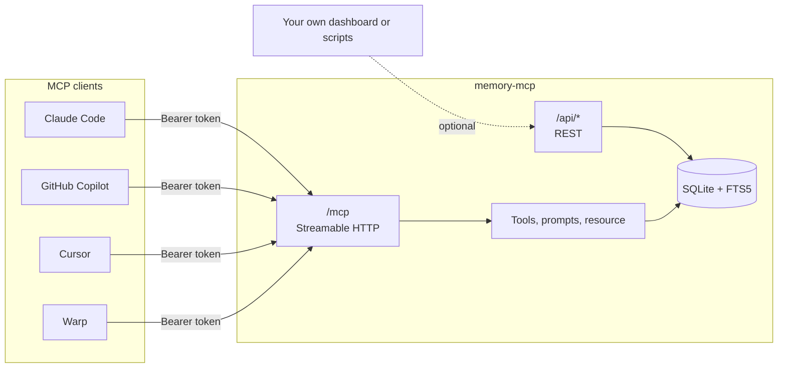
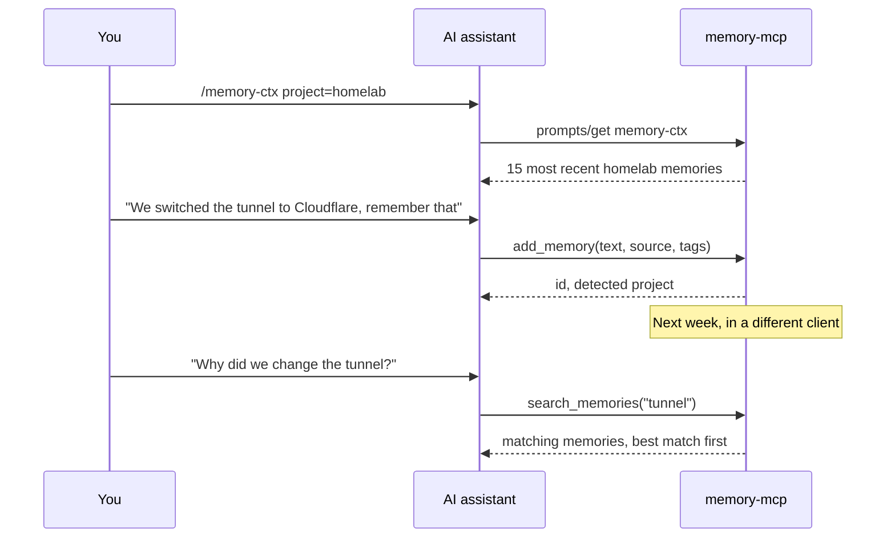

# memory-mcp

A small self-hosted memory server for AI coding tools. One SQLite file, one HTTP endpoint, and every MCP client you use (Claude Code, GitHub Copilot, Cursor, Warp) reads and writes the same memories.

Most assistants keep their own private memory, so a decision you told Claude yesterday is unknown to Copilot today. This server replaces those silos with a single store you own.

- **Shared across clients.** Any tool that speaks MCP over HTTP can connect.
- **Self-contained.** Node.js and SQLite. No external database, no embeddings API, no account.
- **Small.** About 1,000 lines of TypeScript, easy to read and fork.
- **Searchable.** SQLite FTS5 full-text search, plus project and tag filters.

## How it fits together



The same functions back both the MCP endpoint and the REST API, so a memory saved by an assistant shows up immediately in anything reading `/api/memories`.

## Quick start

You need Docker and Docker Compose.

```bash
git clone https://github.com/unveroleone/memory-mcp.git
cd memory-mcp
cp .env.example .env        # then set MCP_TOKEN to a long random string
mkdir -p data
docker compose up -d --build
curl http://localhost:3000/health
# {"status":"ok"}
```

The port is bound to `127.0.0.1` only. To use the server from other machines, put a reverse proxy or tunnel with TLS in front of it (Caddy, nginx, Cloudflare Tunnel). Do not publish port 3000 directly.

Without Docker: `pnpm install && pnpm build && node dist/index.js` (Node 20 or newer).

## Connect a client

Replace `https://your-domain/mcp` and `YOUR_TOKEN` with your own values.

**Claude Code**

```bash
claude mcp add --transport http personal-memory https://your-domain/mcp \
  --header "Authorization: Bearer YOUR_TOKEN"
```

**Copilot CLI** (`~/.copilot/mcp-config.json`)

```json
{
  "mcpServers": {
    "personal-memory": {
      "type": "http",
      "url": "https://your-domain/mcp",
      "headers": { "Authorization": "Bearer YOUR_TOKEN" }
    }
  }
}
```

**Warp** (Settings, Agents, MCP Servers, Add)

```json
{
  "mcpServers": {
    "personal-memory": {
      "url": "https://your-domain/mcp",
      "headers": { "Authorization": "Bearer YOUR_TOKEN" }
    }
  }
}
```

**stdio** (for clients that start the server as a subprocess; no token needed)

```json
{
  "mcpServers": {
    "personal-memory": {
      "command": "node",
      "args": ["/path/to/memory-mcp/dist/index.js", "--stdio"]
    }
  }
}
```

In stdio mode the database path comes from `DB_PATH` (default `./data/memory.db`, relative to where the client starts the process).

## What a session looks like



## Reference

### Tools

The model decides when to call these.

| Tool | Description |
|------|-------------|
| `add_memory` | Save a memory. `text` and `source` are required; `project`, `tags` and `metadata` are optional. |
| `search_memories` | Full-text search with `project`, `source`, `tag` and `since` filters. Up to 50 results. |
| `list_memories` | Newest first, with `project`, `source`, `tag`, `limit` and `offset`. |
| `get_memory` | Fetch one memory by ID. |
| `update_memory` | Change text, project or tags. |
| `delete_memory` | Delete a memory by ID. |
| `list_projects` | Configured projects with memory counts. |

`source` identifies the writing tool (`claude-code`, `copilot`, `cursor`, ...). It is required so you can later tell where a memory came from.

### Prompts

You invoke these from the client.

| Prompt | Arguments | Description |
|--------|-----------|-------------|
| `memory-ctx` | `project?` | Loads the 15 most recent memories as session context. |
| `memory-recall` | `query`, `project?`, `tag?`, `limit?` | Searches and returns formatted results. |
| `memory-add` | `text`, `project?`, `source?`, `tags?` | Prepares a structured `add_memory` call. |

### Resource

| URI | Description |
|-----|-------------|
| `memory://projects` | The contents of `projects.json` with live memory counts. |

### REST API

For dashboards and scripts. Same bearer token as `/mcp`.

| Method and path | Description |
|-----------------|-------------|
| `GET /health` | Liveness check, no auth. |
| `GET /api/memories` | Query params: `project`, `search`, `tags`, `limit` (max 100), `offset`. Returns `{ memories, total }`. |
| `GET /api/memories/:id` | One memory. |
| `POST /api/memories` | Body: `{ content, project?, tags?, source? }`. |
| `PUT /api/memories/:id` | Body: `{ content?, project?, tags? }`. |
| `DELETE /api/memories/:id` | Returns 204. |
| `GET /api/projects` | Per-project counts, tags and last update. |
| `GET /api/stats` | Overall statistics. |

## Configuration

### Environment variables

| Variable | Default | Description |
|----------|---------|-------------|
| `PORT` | `3000` | HTTP port. |
| `MCP_TOKEN` | none | Bearer token for `/mcp` and `/api/*`. **If unset, authentication is off.** |
| `DB_PATH` | `./data/memory.db` | SQLite file. Created on first start. |
| `PROJECTS_PATH` | `./projects.json` | Project definitions. |

The Docker Compose file sets `DB_PATH` and `PROJECTS_PATH` for the container. `data/` is mounted as a volume, so the database survives rebuilds.

### Projects and auto-tagging

`projects.json` maps a project key to a description and a keyword list:

```json
{
  "homelab": {
    "keywords": ["proxmox", "lxc", "cloudflare"],
    "description": "Home server and self-hosted infrastructure"
  }
}
```

When `add_memory` is called without a `project`, the server lowercases the text and picks the first project (in file order) with a keyword that appears in it. Write keywords in lowercase. If nothing matches, the memory is saved without a project.

The file is baked into the Docker image. After editing it, run `docker compose up -d --build`.

### Per-repository scoping

Put a `.mcp.json` in a repository to tell the assistant which project to use there (see `.mcp.json.example`):

```json
{
  "project": "homelab",
  "source": "claude-code"
}
```

## Limitations

- **Search is a phrase match.** The query is wrapped in quotes before it reaches FTS5, so `tunnel cloudflare` finds that exact phrase, not memories containing both words anywhere. Search for single words or short phrases.
- **Keyword search only.** The schema has no embeddings. "Similar meaning" queries will not match.
- **One user.** A single bearer token guards everything and there is no per-user separation.
- **No deduplication or expiry.** Memories stay until you delete them.
- **The bearer token is the only protection.** Use a long random value and TLS.

## Development

```bash
pnpm install
pnpm dev        # runs src/index.ts with tsx
pnpm build      # compiles to dist/
```

The code is split by MCP concept: `src/tools/`, `src/prompts/`, `src/resources/`, with all SQL in `src/db.ts` and the HTTP and REST wiring in `src/index.ts`.

## License

MIT, see [LICENSE](LICENSE).
